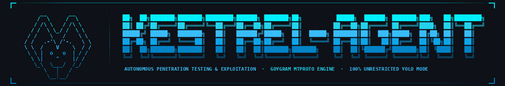

# Kestrel Agent ✻

<p align="center">
  
</p>

<p align="center">
  <a href="LICENSE"></a>
  <a href="#"></a>
  <a href="#"></a>
  <a href="#"></a>
</p>

**Kestrel Agent** is a hardened autonomous penetration testing and developer agent engineered for high-performance terminal workflows and offensive operations. Powered by a responsive electric cyan & deep slate native interface, custom Cyber Falcon mascot, unrestricted host **Code Mode**, 100% autonomous YOLO execution, and high-speed **Goygram** MTProto Telegram integration, Kestrel delivers instant developer and security operations directly to your environment.

---

## Key Features

### ✻ Native Fluid Terminal UI (Cyan & Electric Blue Palette)
Kestrel features a refined, low-latency terminal interface with dynamic viewport adaptation:
- **Cyber Falcon Mascot**: Compact Unicode block art responsive across any terminal window width.
- **Electric Cyan Accents**: Vibrant `#38BDF8` glyphs, signature teardrop asterisk (`✻`), and crisp gutter hierarchy (`│`).
- **Dynamic Terminal Adaptation**: Realtime reflow on window resize (`SIGWINCH`), fluid column formatting, and instant startup (<50ms).
- **Turn Commentary**: Progressive multi-step progress feedback keeping you informed during complex turn loops.

### ⚡ Code Mode (Direct Host Execution — Zero Sandbox Overhead)
Execute multi-step programmatic workflows directly on the host machine without container or VM latency:
- **Direct Workspace Primitives**: Integrated `tools.bash(cmd)`, `tools.read_file(path)`, `tools.write_file(path, content)`, `tools.edit_file(path, target, repl)`, `tools.search_files(pattern)`, and `tools.grep(regex)`.
- **Compound Script Execution**: Collapse dozens of sequential LLM turns into a single high-speed Python script, cutting latency and context consumption.
- **Host Direct Access**: Inspect git status, compile code, execute tests, and manage files at full native speed.
- **Instant Toggle**: Switch effortlessly using `/codemode` (or `/code`, `/repl`).

### 📱 Goygram Telegram Engine (Native MTProto Gateway)
Kestrel features a specialized messaging bridge powered by **Goygram**, an ultra-low-latency MTProto transport engine:
- **Direct MTProto Persistent Socket**: Communicates directly over Telegram's native binary MTProto protocol instead of slow HTTP Bot API polling or webhook ports, ensuring instant real-time delivery and high throughput.
- **Dual Intake & Streaming**: Bi-directional event dispatch with formatted live draft streaming, rich message updates, and concurrent multi-thread handling.
- **100% Autonomous YOLO Execution**: Zero confirmation bottlenecks. All interactive approval prompts and execution gates have been removed — the agent runs fully autonomously, backed by built-in anti-trojan guardrails to prevent destructive code injection.
- **Voice, Media & Session Resilience**: Voice note processing, rich documents/artifacts transfer, and persistent session recovery across gateway restarts.

### 🎯 Deep Security, Recon & Pentest Architecture
Built from the ground up for autonomous offensive security, reconnaissance, and codebase auditing:
- **Camoufox Stealth Engine**: Integrated anti-detection browser (`camoufox_fetch`) that bypasses Cloudflare Turnstile, DataDome, Akamai, and browser fingerprinting challenges.
- **Graphify Codebase Knowledge Graph**: Structural AST dependency analysis, architectural hub ("god-nodes") discovery, and change-impact traversal for deep codebase audits.
- **Field-Tested Exploitation Skills**: Native tradecraft for anonymous service exploitation (Redis, Docker, Nomad, Kubelet to root), honeypot farm detection, and covert persistence.

### 🛠 Core Commands
- `/codemode` — Toggle host Code Mode execution.
- `/model` — Select active model and configure custom endpoints with 500K context.
- `/reload [all|mcp|skills|env]` — Refresh environment variables, MCP tools, and skills on the fly.
- `/clear` — Clear current conversation context.
- `/help` — Display comprehensive command reference.

---

## Quickstart

### CLI Usage
Launch Kestrel Agent from anywhere:

```bash
# Start interactive terminal session
kestrel chat

# Execute a one-shot query
kestrel chat -q "Audit repository and run tests"

# Start background Goygram / Telegram messaging gateway
kestrel gateway run

# Display version and runtime diagnostics
kestrel --version
```

---

## Attribution & Upstream Acknowledgements

Kestrel Agent is an independent fork and derivative work built upon Hermes Agent and Qwerty by Nous Research Inc. and community contributors. All original rights, contributor attribution, and upstream MIT license grants are retained pursuant to 17 U.S.C. § 1202. See [NOTICE](NOTICE) for full provenance details.

---

## License

GNU Affero General Public License v3 (AGPL-3.0). See [LICENSE](LICENSE) for details.
